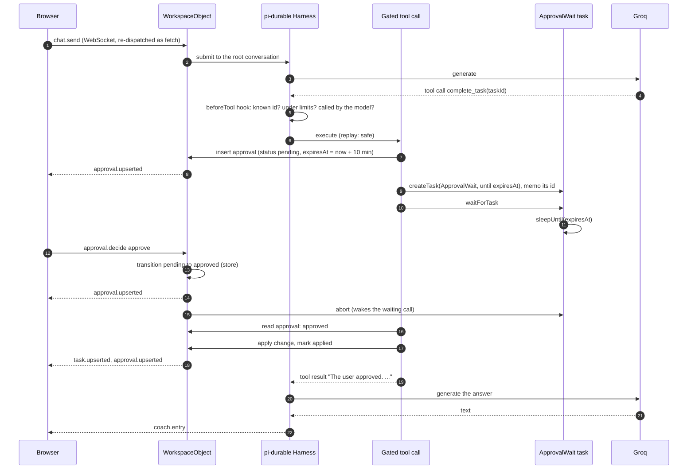

# Architecture

This document follows a request from the browser to the model and back, then covers the data model, the WebSocket
protocol, the approval flow, timers, identity, and the decisions behind them. Every celld workaround is marked
**celld workaround** with the file that holds it.

## Packages

| Path                | Role                                                                                                                                                                                        |
| ------------------- | ------------------------------------------------------------------------------------------------------------------------------------------------------------------------------------------- |
| `packages/protocol` | zod schemas shared by server and client: domain types, HTTP bodies, WebSocket messages                                                                                                      |
| `packages/coach`    | `CoachRuntime`: the pi-durable Harness, the coach's tools, the approval gate, durable tasks, user operations. Runtime-agnostic: it takes a `Storage`, a `WorkspaceStore` and pi-ai `Models` |
| `apps/worker`       | The Worker (`src/index.ts`), `WorkspaceObject` (`src/workspace-object.ts`), the SQLite store, auth, migrations                                                                              |
| `apps/web`          | React SPA. Builds into `apps/worker/public/`, which the runtime serves as static assets                                                                                                     |
| `packages/evals`    | The eval harness; runs `CoachRuntime` on pi-durable `MemoryStorage` in Node                                                                                                                 |

## Request flow

1. The browser loads the SPA from static assets (`not_found_handling: single-page-application`). Only `/api/*` runs
   the Worker first (`run_worker_first`).
2. `GET /api/health` answers without auth. Every other `/api/*` request gets the per-isolate Better Auth runtime
   (`authRuntime` in `src/index.ts`).
3. `/api/auth/*` goes to Better Auth's handler (passkey registration and sign-in, session, sign-out).
4. For everything else, `handleApi`:
   - refuses a state-changing request or a WebSocket upgrade whose `Origin` is not the request's own origin or listed
     in `ALLOWED_ORIGINS` (`originAllowed` in `src/http.ts`);
   - resolves the workspace (`resolveIdentity` in `src/identity.ts`): the signed-in account's `workspaceId`, else the
     anonymous workspace named by the signed `vitask_ws` cookie, else a newly minted one with a `Set-Cookie`.
     WebSocket upgrades never mint: the client loads `/api/snapshot` first;
   - forwards the request to `env.WORKSPACE.get(env.WORKSPACE.idFromName(workspaceId))`.
5. `WorkspaceObject.fetch` serves the REST routes (`src/router.ts`: tasks, timers, session start/end, chat,
   approvals, turn log, snapshot) or accepts the WebSocket.
6. The coach calls Groq through pi-ai. Results reach the browser as WebSocket events.

User actions on tasks and timers go over HTTP and are applied optimistically in the client. Coach commands
(`chat.send`, `approval.decide`) go over the WebSocket and get an `ack` or `error` with the same `requestId`
(`POST /api/chat` and `POST /api/approvals/:id` exist too).

## WorkspaceObject lifecycle

The lifecycle follows the Durable Object example in the pi-durable README.

- **Open.** The constructor runs everything inside `ctx.blockConcurrencyWhile`, so no request sees a half-open
  object:
  1. arm a fallback alarm 60 s out before anything can throw, so a failed open is retried;
  2. run host migrations (`src/migrations.ts`) on `DurableObjectSqliteDatabase`;
  3. `CoachRuntime.open`: `SqliteStorage.open(database, { prefix: "pi_" })` (pi-durable migrates its own tables),
     `Harness.open` with the coach extension, the root (chat) conversation and a system conversation for background
     tasks, the seed data (two default timers), `reconcile` (see below), and the transcript watch;
  4. arm the alarm from `runtime.wake()`, then `runtime.resume()`.
     No model call happens inside `blockConcurrencyWhile`; `resume()` only schedules work.
- **onWake → alarm.** pi-durable reports the next time it needs to run through `onWake`. `#arm` sets the alarm to
  the earliest of that time and, while work is active, a 60 s recovery heartbeat. `beforeWork` arms the heartbeat
  before any call that can start work, so a crash right after a commit is still covered.
- **alarm().** Re-arms with `active: true` and calls `resume()`. pi-durable picks up every task whose sleep is due or
  whose step was interrupted.
- **fetch().** Routes the request, then arms the alarm again before returning.
  **celld workaround** (`fetch` in `src/workspace-object.ts`): an alarm set inside the event before the response is
  durable when the response is sent; one set later from `onWake`'s microtask was lost by a celld crash in testing.
- **Keep open.** **celld workaround** (`#keepOpen` in `src/workspace-object.ts`): celld lets an object's background
  work outlive its event only while I/O is pending. pi-durable's scheduler has gaps between steps, so a woken tool
  call stalled until the next heartbeat (approve to answer took 61 s). Every fetch and alarm now holds the event open
  with `ctx.waitUntil` while `wake().active` is true, for at most 30 s. On Cloudflare this costs nothing.
- **Failure.** If the Harness closes with a failure (a storage error), the object calls `ctx.abort()`; the next event
  constructs it again and recovery runs. A failed alarm write also aborts.
- **Resume after a crash.** pi-durable replays from its checkpoints. Tools marked `replay: "safe"` use `api.memo` for
  ids and deadlines, and every durable task phase checks the store before writing, so a rerun does not duplicate
  anything.

## Data model

One SQLite database per workspace. Host tables (`apps/worker/src/migrations.ts`, version 1):

| Table               | Holds                                                                                                                 |
| ------------------- | --------------------------------------------------------------------------------------------------------------------- |
| `meta`              | Key/value bookkeeping (seed done, system conversation id)                                                             |
| `tasks`             | Tasks and steps (`parent_id`), status, estimate, sort order, completion time                                          |
| `care_timers`       | Label, purpose, instructions, interval, enabled, appearance, `next_fire_at`, durable task id                          |
| `sessions`          | Focus sessions: status (`active`, `wrapping_up`, `ended`), max end, debrief, guard and wrap-up task ids, handoff time |
| `nudges`            | One row per timer fire, unique on `(timer_id, fired_at)`                                                              |
| `hypes`             | One celebration per completed task                                                                                    |
| `memory_facts`      | Remembered facts (at most 30, 280 characters each)                                                                    |
| `approvals`         | Proposed changes: tool, arguments, summary, status, expiry, result, wait task id                                      |
| `plans`             | Focus-block plans from `plan_focus_blocks`                                                                            |
| `turn_log`          | One row per model request: trigger, model, tokens, cost, latency, tools, outcome                                      |
| `chat_events`       | Timestamps of chat submissions, for the per-minute rate limit                                                         |
| `schema_migrations` | Applied host migrations                                                                                               |

pi-durable's tables, prefixed `pi_`: conversations, entries, submissions, tasks, documents and document revisions,
record ids, and durable metadata. The coach transcript, run state, task checkpoints and sleeps all live there, in
the same database and the same transactions as the app tables.

D1 (`vitask-auth`, `apps/worker/migrations/`) holds only Better Auth's `user` (with `workspaceId`), `session`,
`account`, `verification`, `passkey` and `rateLimit` tables.

## WebSocket protocol

Defined in `packages/protocol/src/ws.ts`. Path `/api/ws?protocol=1`; the server refuses other versions.

- On connect the server sends `hello` with a full `Snapshot`. After that, one event per change: `task.upserted`,
  `task.deleted`, `timer.upserted`, `timer.deleted`, `session.updated`, `nudge`, `hype`, `approval.upserted`,
  `memory.updated`, `plan.updated`, `coach.entry` (a committed transcript item, ids increase), `coach.live` (the
  streamed text and running tools, sent whole on each change), `turn.logged`, `budget.updated`.
- Client messages: `ping` (answered with `pong`), `resync` (answered with a new `hello`), `chat.send` and
  `approval.decide` (answered with `ack` or `error` carrying the same `requestId`).
- No replay. A client that reconnects asks for `resync` and replaces its copy. The client
  (`apps/web/src/state/socket.ts`) reconnects with jittered backoff, retries at once when the tab becomes visible or
  the browser comes online, and pings to detect dead connections.
- The sockets are hibernatable (`ctx.acceptWebSocket`); broadcasts go to `ctx.getWebSockets()`.
- **celld workaround** (`#dispatchCommand` / `#runCommand` in `src/workspace-object.ts`): celld ends a
  `webSocketMessage` event's I/O when the handler returns, so durable work started from a socket command failed with
  "the cell event ended before it could acquire an input gate" and took the Harness down. Socket commands are
  re-dispatched as a fetch to the object's own stub at `/internal/command`, which keeps pending I/O alive on both
  runtimes. The path is unreachable from outside because the Worker forwards only `/api/*`.
- `webSocketClose` does not echo codes 1005 and 1006, which cannot be sent (celld raises `InvalidAccessError`).

## Approval flow

pi-durable 1.5.2 has no signals (they exist only on `main`), so a tool call cannot park on an external event. The
gate (`packages/coach/src/gate.ts`) builds the wait from 1.5.2 primitives: a child task that sleeps until the
deadline, and an abort as the wake-up. The decision itself lives in the `approvals` table.

- **Reject**: the store says `rejected`; the tool returns "The user rejected this change; nothing changed." as an
  error result.
- **Expiry**: nobody aborts the child; it wakes at `expiresAt`, and the call marks the approval `expired`.
- **Session end** expires every pending approval and aborts their waits.
- **Restart during the wait**: the call reruns, finds its approval id and wait task id through memos, checks the
  store before waiting again, and never creates a second approval. `apply` is idempotent per approval id (the new
  task's id derives from it).
- The `beforeTool` hook refuses before you are asked: unknown task or timer ids, limits, more than 5 pending
  proposals, and mutating calls whose caller is another tool rather than the model. The rule is in code, so nothing in
  the conversation can disable it.

When pi-durable ships signals, `ApprovalWait` and the abort go away: the tool parks, and the decision is a signal.

## Care timers

- Starting a session spawns, on the system conversation, one `vitask.care-timer` task per enabled timer and one
  `vitask.session-guard` that ends the session at its maximum length (`packages/coach/src/tasks.ts`).
- A care-timer task alternates `wait` (`sleepUntil(fireAt)`) and `fire`: it checks the session is active and the
  timer enabled, writes a nudge unless one exists for `(timer, fireAt)`, sets the next fire time and sleeps again.
  After downtime longer than an interval it skips the missed fires instead of sending a burst.
- Nudge text comes from `generateOneShot`: a single model call with a 20 s timeout. Over budget, on a provider error
  or an empty answer it uses a canned fallback. Every attempt is logged in `turn_log`.
- `reconcile` runs at open and after every session change: an active session must have a live guard and a live task
  per enabled timer, and a session that is wrapping up must have a wrap-up task. A crash between a store write and a
  task creation heals on the next start.
- Durability: the sleeps are pi-durable rows in the object's SQLite, and the object's alarm wakes it. On Cloudflare
  and `wrangler dev` a due timer fires on time after a restart. On celld 0.6.3, after `kill -9` of the node, it fires
  through the 60 s recovery heartbeat instead (up to about a minute late, never lost; not root-caused).
- The wrap-up task writes the debrief from the session's history, then resets the root conversation with a handoff
  note, so the next session starts with a short summary instead of the whole transcript.

## Identity and accounts

- **Anonymous**: the `vitask_ws` cookie holds `workspaceId.HMAC(COOKIE_SECRET, "workspace:" + workspaceId)`. No
  server row. `HttpOnly`, `SameSite=Lax`, one year, `Secure` when `BETTER_AUTH_URL` is https.
- **Account**: a Better Auth user (passkey only) with a unique `workspaceId`. The `user.create.before` hook
  (`src/auth.ts`) is the only place that picks it: the visitor's anonymous workspace if the cookie is valid and no
  account owns it, otherwise a new id. Signing up keeps your data.
- Once an account owns a workspace, the anonymous cookie naming it stops working (`anonymousWorkspace` checks D1).
  Signing out therefore gives a fresh, empty anonymous workspace without clearing cookies. Signing in from an
  anonymous browser opens the account's workspace and leaves the anonymous one alone (no merge).
- Passkeys: `rpID` is the hostname of `BETTER_AUTH_URL`. Sign-up is passkey-first: registration without a session
  creates the user (`requireSession: false`, `resolveUser`, `afterVerification`). The account gets a placeholder
  email under `.invalid` because Better Auth requires one.
- The session is read with `disableRefresh` on API requests (the auth handler owns the cookies) and cached in a
  signed cookie for 5 minutes, so most requests skip D1. A revoked session can keep working elsewhere for up to
  5 minutes.
- **celld workaround** (`authRuntime` in `src/index.ts`): on celld 0.6.3, a request that awaits a promise settled by
  I/O another request started cannot start I/O of its own; its D1 queries and timers never complete. Better Auth
  initialises with D1 queries, so the per-isolate instance is cached only after `await auth.$context` in the request
  that built it; concurrent cold requests each build their own.
- **celld workaround** (`src/dev-migrations.ts`, development only): `celld d1 migrations apply` cannot reach the
  local store of `celld dev`, so with `D1_DEV_MIGRATIONS=apply` (set only in `.dev.vars` and the test harnesses)
  the Worker applies `migrations/` itself, recording them in the same `d1_migrations` table. A concurrent apply by
  another isolate is tolerated by re-reading that table after a failed exec.
- **celld limitation**: celld sets no client-IP header. Better Auth reads `cf-connecting-ip` or `x-real-ip`; without
  a proxy that sets one, its rate limit is one shared bucket per path.

## Configuration

`wrangler.jsonc` `vars`, read by `src/env.ts`:

| Variable                              | Default                       | Meaning                                                            |
| ------------------------------------- | ----------------------------- | ------------------------------------------------------------------ |
| `COACH_PROVIDER`, `COACH_MODEL`       | `groq`, `openai/gpt-oss-120b` | Model; add a provider in `PROVIDERS` in `src/env.ts`               |
| `GROQ_API_KEY`                        | (secret)                      | Provider key                                                       |
| `DAILY_TOKEN_BUDGET`                  | 200000                        | Tokens per workspace per UTC day                                   |
| `CHAT_RATE_LIMIT_PER_MINUTE`          | 10                            | Chat submissions per workspace per rolling minute                  |
| `MAX_SESSION_MINUTES`                 | 240                           | Sessions end by themselves after this                              |
| `MIN_TIMER_INTERVAL_SECONDS`          | 60                            | Shortest care-timer interval                                       |
| `APPROVAL_TTL_SECONDS`                | 600                           | How long a proposal waits                                          |
| `ALLOWED_ORIGINS`                     | empty                         | Extra origins allowed to call the API                              |
| `BETTER_AUTH_URL`                     | `http://localhost:5173`       | The app's public origin; passkeys bind to its hostname             |
| `BETTER_AUTH_SECRET`, `COOKIE_SECRET` | dev-only values               | Must be replaced in any deployment (the deploy script enforces it) |
| `D1_DEV_MIGRATIONS`                   | unset                         | `apply` in development on celld only                               |

## Decisions and trade-offs

- **celld instead of Cloudflare.** The point of the project is a stateful, per-user agent that I can run on my own
  machines with state in my own bucket. celld runs the Workers/Durable Objects API unchanged, so the code is not
  locked in: the same Worker runs on `wrangler dev` and deploys to Cloudflare. The cost is a beta runtime: four
  workarounds above, no secrets, a late timer after a hard crash, and less tooling. Every workaround is commented
  in place and marked to remove once celld fixes it.
- **pi-durable instead of another agent framework.** Most agent frameworks keep the loop in memory and leave
  durability to you. pi-durable checkpoints each step into the same SQLite as the app data, runs durable tasks with
  sleeps (timers, approvals, the session guard), and gives an `onWake` hook that maps directly onto a Durable Object
  alarm. That made "approval waits survive a restart" a property of the storage, not extra code. The trade-off: a
  young library (1.5.2) whose signals were not released yet, hence the child-task wait.
- **WebSockets instead of Durable Streams.** v1 used Durable Streams for session events. In v2 the state already
  lives in the object that holds the sockets, so a hibernatable WebSocket with a snapshot on connect and one event
  per change is simpler: no second store, no offsets, and a reconnect just resyncs. Lost events cannot leave the
  client wrong because every reconnect replaces its copy.
- **No SSR.** The app is behind a per-user workspace and is useless without JavaScript and a socket, so server
  rendering would add a rendering runtime to the Worker for no SEO or first-paint gain worth having. A static SPA is
  served by the runtime's asset handling and the Worker runs only for `/api/*`.
- **One reducer store, no data library.** The server pushes every change, so the client is a pure reducer over the
  snapshot plus optimistic operations and queued chats. TanStack Query's cache would duplicate that.
- **Passkeys only.** No passwords to store or reset, no email to verify. GitHub sign-in was built and then removed to
  keep one path well tested.
